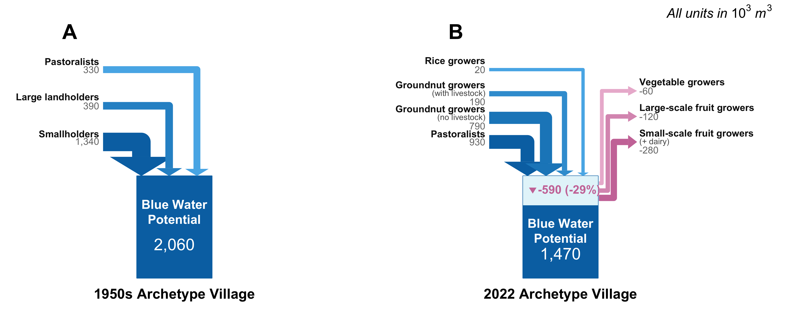

# 1. Overview

This is the main reproducible report a Supplementary Information to, and a Computational Implementation-cum-Reproducible Workflow for Hemingway, C. et al. (2026). Accounting for the unaccounted: a new framework for incorporating farm social diversity in micro-regional water budgets. *[Journal Name]*. [DOI Link].

This repository provides a generalized computational framework for simulating Blue Water Potential at the village level given area under various Cropping Systems and Climate. While this specific implementation is configured to reproduce the results and figures for **Accounting for the unaccounted: a new framework for incorporating farm social diversity in micro-regional water budgets**, the underlying R code is designed to be adaptable for any site with meteorological and cropping system data. See README for instructions on how to apply this framework to a different study site.

# 2. Workflow
# Prerequisites and Repository Structure

> **For Public Users Reproducing this Workflow:**
> This toolkit requires a specific directory structure to function correctly. Ensure your R working directory (ideally managed via an `.Rproj` file) contains the following root folders:
> * `/data/processed/` (Containing your meteorological and crop matrices)
> * `/code/` (Containing the companion execution scripts)
> 
> The script will automatically generate the required `/output/` and `/figures/` directories during execution.

# Global chunk configurations

```{r setup, include=FALSE}
knitr::opts_chunk$set(
  echo = TRUE,      
  message = FALSE,  
  warning = FALSE
)

options(width = 80)

# Load core dependencies
if (!require("pacman")) install.packages("pacman"); library(pacman)
pacman::p_load(tidyverse, ggpubr, parallel, mcprogress, pbapply, patchwork, RColorBrewer, ggtext, ggarrow, networkD3, htmlwidgets, webshot2, htmltools, here)

# Generate directory framework if missing
required_dirs <- list(
  "figures", "figures/crop_kc_curves", "figures/water_budgets", 
  "figures/manuscript", "figures/presentation", "output", "output/water_budgets"
)
lapply(required_dirs, function(x) if (!dir.exists(x)) {dir.create(x, showWarnings = FALSE)})
```

## Load Engine Functions

These external modular scripts handle calculations behind the scenes, processing parameters such as daily reference evapotranspiration ($ET_0$) and crop coefficient ($K_c$) curves.

```{r load-functions}
source("code/01_function_get_Peff.R")
source("code/03_function_expand_kc.R")
source("code/04_function_get_budget.R")
source("code/05_function_get_figures.R")

quantile_df <- function(x, probs = c(0.025, 0.5, 0.975)) {
    tibble(quantile = probs, value = quantile(x, probs, na.rm = TRUE))
}
```

# Data Ingestion & Climatology Validation

```{r load-met, results='asis'}
# 1. Meteorological Forcing
precip <- read.csv(file = "data/processed/01_precipitation.csv", header = TRUE) 
years.range <- range(as.numeric(format(strptime(precip$date, format = "%Y-%m-%d"), format = "%Y")))
years.range.plot <- paste(years.range[1], ":", years.range[2])

et0 <- read.csv(file = "data/processed/02_et0.csv", header = TRUE) 
et0.timestep = "daily" 

# Display previews
cat("### Precipitation Data Sample\n"); print(knitr::kable(head(precip, 3)))
cat("\n### Reference Evapotranspiration Data Sample\n"); print(knitr::kable(head(et0, 3)))
```

### Climatological Profile Summary

```{r fig.1, echo = FALSE, fig.width=11, fig.height=6.5, out.width="100%", fig.align = 'center', fig.cap = 'Figure 1. Monthly baseline metrics showing mean rainfall, temperature, and reference evapotranspiration.'}
climate_summary <- read.csv(file = "data/processed/03_climatology_for_figure.csv", header = TRUE)

fig.1_journal <- plot_climate_profile(climate_summary)

ggsave(plot = fig.1_journal, filename = "figures/manuscript/Fig.1_Regional_Monthly_Climate_Profile.tiff", width = 180, height = 90, units = "mm", dpi = 300, compression = "lzw")
print(fig.1_journal)
```

## Landscape & Cropping Parameter Ingestion

We load the physical attributes governing the water calculations, including soil structures, crop rooting parameters, and spatial setups.

```{r load-soil-and-crop, results='asis'}
# Soil Parameter Matrix
soil.param <- read.csv(file = "data/processed/04_soil.parameters.csv", header = TRUE)
cat("### Soil Parameter Matrix\n"); print(knitr::kable(soil.param))

# Crop Phenology Parameters
crop.param <- read.csv(file = "data/processed/05_crop.parameters.csv", header = TRUE)
cat("\n### Crop Phenology Matrix (Sample)\n"); print(knitr::kable(head(crop.param, 3)))

# Cropping Systems Definitions
crop.systems.l <- read.csv(file = "data/processed/06_crop.systems.l.csv", header = TRUE)
crop.systems <- read.csv(file = "data/processed/07_crop.systems.csv", header = TRUE)
load(file = "data/processed/08_crop.rotation.kc.ls.Rdata")

cat("\n### Active Cropping Systems\n"); print(knitr::kable(head(crop.systems, 3)))
```

```{r fig.2, echo = FALSE, fig.align = 'center', fig.cap="Figure 2. Annual Crop Coefficient (Kc) curves mapped across distinct plant rotations."}
crop.systems.l.kc <- bind_rows(crop.rotation.kc.ls, .id = "rotation")

fig.2_journal <- plot_crop_coefficient_curves(crop.systems.l.kc)

ggsave(plot = fig.2_journal, filename = "figures/manuscript/Fig.2_Crop_Coefficient_Curves_by_Rotation.png", width = 180, height = 225, units = "mm", dpi = 300)
print(fig.2_journal)
```

## Production Systems & Socio-Agricultural Composition

These files map management configurations to specific farm profiles and track historical structural changes.

```{r social-ingestion, results='asis'}
ps_by_cs_area <- read.csv(file = "data/processed/09_crop_system_area_by_production_system.csv", header = TRUE)
farms_count_df <- read.csv(file = "data/processed/10_no_of_farmers_by_production_system_1950_and_2022.csv", header = TRUE)

cat("### Production System Area Splits\n"); print(knitr::kable(head(ps_by_cs_area, 3)))
cat("\n### Historical Household Counts\n"); print(knitr::kable(head(farms_count_df, 3)))
```

---

# Core Hydrology Execution Engine

We first transform crude precipitation fields into site-specific effective inputs ($P_{\text{eff}}$), accounting for runoff parameters ($CN$), before running the parallel iterative budget engine.

```{r set_param_budget}
p.list <- list(precip = precip,
               et0 = et0,
               et0.timestep = et0.timestep, 
               CN = 85, 
               soil.input = "P", 
               soil.param = soil.param,
               sm.init = 0.5,
               crop.param = crop.param,
               kc_no_crop = list(summer = 0.005, kharip_rabi = 0.2))

# Vectorized generation of effective precipitation models across targeted horizons
met.forcing.ls <- lapply(as.list(soil.param$soil), function(x) {
  get_peff_et0(p = p.list, soil = x)
})
names(met.forcing.ls) <- soil.param$soil 
```

## Running the Parallel Processing Core

The code block below handles multi-core processing to run individual water balances across your rotations simultaneously.

```{r engine, eval = FALSE}
# Multi-Core Setup
num_cores <- parallel::detectCores(logical = FALSE) 
cl <- makeCluster(num_cores, type = "PSOCK") 

clusterExport(cl, varlist = c("p.list", "met.forcing.ls", "get_budget", "quantile_df"), envir = environment()) 
clusterEvalQ(cl, {library(tidyverse); library(ggpubr)})

# Process budget arrays
budget <- pblapply(crop.rotation.kc.ls, get_budget, cl = cl, p = p.list, ts = met.forcing.ls)
stopCluster(cl)

names(budget) <- names(crop.rotation.kc.ls)
save(budget, file = "output/water_budgets/processed_water_budgets.Rdata")
```

```{r load-precalculated-budgets, include=FALSE}
# Internal loading mechanism for the knitted output
load(file = "output/water_budgets/01_Budget.Rdata")
```

# Output Processing & BWP Calculations

We transform daily flux models into annual summaries, saving structured outputs to the `output/water_budgets/` directory for downstream analysis.

```{r compile-outputs}
budget.daily.ls <- lapply(budget, function(x) {return(x$ts)})
budget.daily <- dplyr::bind_rows(budget.daily.ls, .id = "rotation") %>% 
  left_join(crop.systems, by = "rotation")

# Save detailed daily data metrics
write.csv(budget.daily, file = "output/water_budgets/export_detailed_daily_water_budgets.csv", row.names = FALSE)

# Generate annual long-format metrics
budget.yr.ls <- lapply(budget, function(x) {return(x$sum.yr)})
budget.yr.l <- dplyr::bind_rows(budget.yr.ls, .id = "rotation") %>% 
    pivot_longer(cols = c(-rotation, -year), names_to = "var", values_to = "value") %>%
  left_join(crop.systems, by = "rotation")
write.csv(budget.yr.l, file = "output/water_budgets/export_annual_water_budgets_long.csv", row.names = FALSE)

summary_yr_budgets <- process_annual_budget(budget, crop.systems)
summ.qs.cs <- summary_yr_budgets$summ_qs_cs

bwp <- summ.qs.cs %>% 
  subset(var == "balance") %>%
  select(-var, -var.plot)
colnames(bwp)[-c(1,2)] <- paste0("BWP_", colnames(bwp)[-c(1,2)])

write.csv(bwp, file = "output/water_budgets/calculated_crop_system_blue_water_potential.csv", row.names = FALSE)
```

# Visualizing Cropping System Fluxes

### Annual Climatology: Supply vs. Demand

The following chart compares the irrigation requirements of different cropping choices against their natural groundwater recharge capacity.

```{r annual-wb, fig.align='center', echo=FALSE, fig.cap = "Figure 3. Annual Climatology (mean + 95 CI; 1980-2018) of Water Supply and Demand for various cropping systems in Anantapur. Groundwater Recharge is depicted in negative terms of the water fluxes axis."}
vars_sd <- c("Irrigation Requirement (mm)", "Groundwater Recharge (mm)", "Crop ET Supply:Demand")
plot_annual_climatology(summ.qs.cs, vars_sd, "mean", "Mean Annual Fluxes (95% CI)")
```

### Blue Water Potential ($BWP$) by Cropping System

This plot highlights which systems act as net water consumers ($BWP < 0$) versus net water contributors ($BWP > 0$).

```{r annual-bwp, fig.align='center', echo=FALSE, fig.cap = "Figure 4. Annual Climatology of Blue Water Potential/BWP (mean + 95 CI; 1980-2018) for various cropping systems in Anantapur."}
plot_annual_climatology(summ.qs.cs, "Blue Water Potential (mm)", "mean", "Blue Water Potential [Recharge - Irrigation] (mm)")
```

# Socio-Hydrological Aggregation: Production System Impact

By combining physical water tracking with farm survey data, we aggregate individual cropping footprints into broader socio-economic farm classifications. This step highlights how diverse management approaches alter local water tables.

## Understanding the Landscape Dynamics: Net Consumers vs. Contributors

When interpreting the $BWP$ output at a farm production system scale, distinct patterns emerge based on land use and irrigation intensity:

* **Irrigated Farms (Negative BWP):** Commercial production systems focusing on water-intensive perennials or cash crops (e.g., grape vines, pomegranate, sweet lime, or paddy rice) exhibit a heavily **negative BWP**. Their management relies on continuous, high-volume groundwater extraction. Because their artificial irrigation requirement drastically exceeds the local natural monsoon recharge capacity over their cultivated acreage, they act as chronic hydrological net consumers.
* **Rainfed Farms & Grasslands (Positive BWP):** Traditional smallholders cultivating rainfed crops (e.g., monsoon groundnut or redgram) and pastoralists managing native grasslands exhibit a **positive BWP**. These systems operate without active groundwater pumping. They serve as hydrological net contributors because a substantial fraction of seasonal monsoon precipitation escapes plant evapotranspiration and infiltrates downwards, actively recharging the regional aquifer.

```{r Run_Aggregation, echo=TRUE}
ps_results <- get_production_system_budgets(budget.yr.l, ps_by_cs_area, farms_count_df)

ps_budget_summary  <- ps_results$ps_budget_summary
ps_volumetric_summary <- ps_results$ps_volumetric_summary
ps_bwp_volumetric <- ps_results$ps_bwp_volumetric
write.csv(ps_bwp_volumetric, file = "output/water_budgets/production_system_bwp_contributions.csv", row.names = FALSE)
```

```{r ann-social, fig.width=10, fig.height=5.65, out.width="100%", fig.align = 'center', fig.cap = 'Figure 5. Comparative annual Blue Water Potential ($BWP$) across farm types (1950s vs. 2022).'}
fig.3_social <- plot_socio_economic_bwp(ps_bwp_volumetric)

ggsave("figures/manuscript/Fig.5_Socio_Economic_Group_BWP.png", fig.3_social, width = 10, height = 5.65, dpi = 300, bg = "white")
print(fig.3_social)
```

## Farm-Level BWP Disparity: Demographic Distribution vs. Volumetric Impact

Scaling BWP by farm typology reveals the distribution of net water extraction across the agricultural landscape. By aggregating the water budgets of all cropping systems managed by specific farm types, the data demonstrates that small-scale fruit and vegetable growers account for the majority of the negative BWP. Conversely, rainfed groundnut growers and pastoralists maintain a relatively neutral or positive water balance. A very small number of fruit or vegetable growers consume a massive, disproportionate volume of groundwater, generating severe localized deficits. However, because the rural landscape is numerically dominated by hundreds of small landholding rainfed farmers and pastoralists who maintain positive water balances over extensive acreages, their cumulative recharge acts as a massive buffer. This demographic and physical buffering explains why a village's total combined $BWP$ can remain net-positive despite intensive local extraction: the structural sustainability of the collective watershed resource is being subsidized by the low-impact practices of the resource-poor majority.

```{r disparity-plot, fig.width=11, fig.height=5.5, out.width="100%", fig.align = 'center', fig.cap = 'Figure 6. Farm-level demographic composition (left panel) and net Blue Water Potential (BWP) (right panel). Demographic data reflect total farm counts, while BWP values signify the cumulative water budget (thousand m³) aggregated by farm typology. Negative values indicate production systems with a net groundwater deficit; positive values indicate a net surplus'}
fig_disparity <- plot_farm_bwp_disparity(ps_bwp_volumetric)

ggsave("figures/manuscript/Fig.6_Farm_BWP_Disparity.png", fig_disparity, width = 11, height = 5.5, dpi = 300, bg = "white")
print(fig_disparity)
```

# Macro Landscape Analysis: Historical Village Comparison

Finally, we aggregate farm-level balances to model a full archetype village. This visualization illustrates the net shift in regional water sustainability over the last several decades, comparing the village hydrology of the 1950s against modern configurations.

Crucially, this macro-level aggregation highlights a structural tipping point in regional water security. The baseline 1950s archetype demonstrates a robust hydrological surplus, acting as a net contributor to the underlying aquifer. In contrast, the 2022 configuration illustrates a system inverted by agricultural intensification. The cumulative extraction demands of intensive cropping typologies now overwhelmingly outpace the buffering capacity of rainfed systems, driving the village into a severe, systemic groundwater deficit.

```{r village-bwp, eval=TRUE, echo=TRUE, fig.width=17, fig.height=9.5, out.width="100%", fig.align = 'center', fig.cap= "Figure 7. Annual Blue Water Potential of the archetype village in the 1950s (left) and 2022 (right)."}
village.bwp_collapsed <- ps_bwp_volumetric %>%
  mutate(bwp_thousand_m3 = round(total_vol_m3/10000)*10) %>%
  select(time_period, production_system, bwp_thousand_m3) %>%
  mutate(production_system = case_when(
    production_system == "Landless pastoralists" ~ "Pastoralists",
    production_system == "Sheep fatteners" ~ "Pastoralists",
    production_system %in% c("Rainfed groundnut growers (with buffaloes)", "Rainfed groundnut growers (with bulls)", "Rainfed groundnut growers (with local cows)") ~ "Groundnut growers (with livestock)",
    production_system %in% c("Rainfed groundnut growers (no livestock)", "Rainfed redgram growers (no livestock)") ~ "Groundnut growers (no livestock)",
    production_system == "Rice growers" ~ "Rice growers", 
    production_system %in% c("Small-scale fruit growers (banana)", "Small-scale fruit growers (grape vines)", "Small-scale fruit growers (pomegranate)", "Small-scale fruit growers (sweet lime)") ~ "Small-scale fruit growers (+ dairy)",
    production_system %in% c("Vegetable growers (no livestock)", "Vegetable growers with dairy farming") ~ "Vegetable growers",
    TRUE ~ as.character(production_system)
  )) %>%
  group_by(time_period, production_system) %>%
  summarise(bwp_thousand_m3 = sum(bwp_thousand_m3), .groups = "drop")

colnames(village.bwp_collapsed) <- c("period", "label", "val")

cfg <- list(box_width = 100, min_arrow_w = 5, max_arrow_w = 30, v_stagger_out = 3000)

# Build comprehensive system maps
invisible(plot_village_bwp(
  village_bwp_collapsed = village.bwp_collapsed, 
  cfg = cfg, 
  output_dev = cairo_pdf, 
  filename = "figures/manuscript/Fig.7_Historical_Village_Water_Tank_Comparison.pdf",
  manuscript_style = TRUE
))
invisible(plot_village_bwp(
  village_bwp_collapsed = village.bwp_collapsed, 
  cfg = cfg, 
  output_dev = png, 
  filename = "figures/presentation/Fig.7_Historical_Village_Water_Tank_Comparison.png",
  manuscript_style = FALSE
))

```

# Village Water Balance

While the previous analysis evaluates net potential, Figure 8 employs a strict water accounting framework (Inflows = Outflows) to trace the absolute volumetric movement of water through the village ecosystem. This flow visualization demonstrates how the partitioning of relatively constant atmospheric input (Precipitation) has been fundamentally altered by shifting agricultural practices.

In the 1950s, a substantial fraction of incoming rainfall bypassed the evapotranspiration demands of rainfed crops and native grasslands, generating a robust regional Blue Water Potential (BWP). By 2022, the transition toward water-intensive agriculture drastically reroutes this hydrology. While precipitation remains stable, the massive evapotranspiration demands of irrigated crops now consume a significantly larger slice of the incoming water budget. Consequently, the village-level surplus is severely diminished, illustrating how modern agricultural production in the region physically constricts long-term aquifer replenishment.

```{r village-budget, eval=TRUE, echo=TRUE, out.width="100%"}
# ==============================================================================
# 8. Village Average Annual Water Balance Two-Panel Comparative Layout (Figure 8)
# ==============================================================================

# System environment patch to secure local browser port streaming under macOS
Sys.setenv(CHROMOTE_CHROME = "/Applications/Google Chrome.app/Contents/MacOS/Google Chrome")
Sys.setenv(CHROMOTE_ARGS = "--disable-gpu --no-sandbox --disable-dev-shm-usage")

# 1. Build Individual Synchronized Panels
sankey_1950s <- get_d3_sankey(ps_volumetric_summary, "1950s", font_size = 12)
sankey_2022  <- get_d3_sankey(ps_volumetric_summary, "2022", font_size = 12)

# 2. Bind Into a Unified Comparative HTML Tag List containing a CSS Reset and Caption
combined_water_balance_panels <- htmltools::tagList(
  htmltools::tags$head(
    htmltools::tags$style("
      body { margin: 0 !important; padding: 0 !important; background-color: white; }
      .master-canvas { display: flex; justify-content: space-between; align-items: flex-start; width: 100%; padding: 20px 0; box-sizing: border-box; }
      .panel-column { width: 48%; }
      .custom-caption { text-align: left; font-size: 14px; font-family: 'Helvetica Neue', Helvetica, Arial, sans-serif; color: #333; margin-top: 15px; line-height: 1.6; }
    ")
  ),
  htmltools::tags$div(
    class = "master-canvas",
    # Left Column: Panel A (1950s)
    htmltools::tags$div(
      class = "panel-column",
      style = "border-right: 2px dashed #e0e0e0; padding-right: 15px;",
      htmltools::tags$h3(style = "text-align: center; margin-bottom: 20px; font-size: 18px; color: #2c3e50; font-family: sans-serif; font-weight: bold;", 
                          "A) 1950s Baseline Village Water Balance"),
      sankey_1950s
    ),
    # Right Column: Panel B (2022)
    htmltools::tags$div(
      class = "panel-column",
      style = "padding-left: 15px;",
      htmltools::tags$h3(style = "text-align: center; margin-bottom: 20px; font-size: 18px; color: #2c3e50; font-family: sans-serif; font-weight: bold;", 
                          "B) 2022 Intensified Village Water Balance"),
      sankey_2022
    )
  ),
  # Embedded HTML Caption to bypass RMarkdown's static image limitation
  htmltools::tags$div(
    class = "custom-caption",
    htmltools::HTML("<b>Figure 8.</b> Average annual water balance of the archetype village in the 1950s (A) and 2022 (B), based on 37 years of climate data (1980–2018) and following a ‘water accounting’ approach. Values are rounded to the nearest ten thousand cubic metres and expressed in thousands (10&sup3; m³).")
  )
)

# 3. Export Consolidated Multi-Panel Layout to Publication Files
htmltools::save_html(combined_water_balance_panels, "temp_combined_sankey.html")

# Ensure widget is fully mounted before snapshot
Sys.sleep(2) 

# Take snapshot with expanded vwidth boundary envelope
invisible(webshot2::webshot(
  url = "temp_combined_sankey.html", 
  file = "figures/presentation/Fig.8_Village_Water_Balance_Sankey_2Panels.png", 
  vwidth = 1620, 
  vheight = 650, 
  zoom = 2
))

invisible(webshot2::webshot(
  url = "temp_combined_sankey.html", 
  file = "figures/manuscript/Fig.8_Village_Water_Balance_Sankey_2Panels.pdf", 
  vwidth = 1620, 
  vheight = 650
))

unlink("temp_combined_sankey.html")

# Render live seamlessly inside your knitted HTML workflow documentation
htmltools::browsable(combined_water_balance_panels)
```